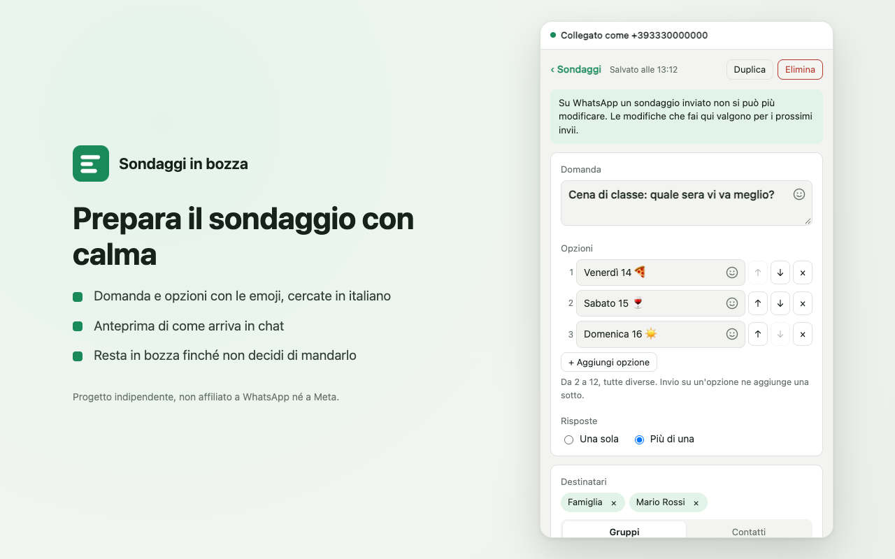

# Sondaggi in bozza

Un'estensione di Chrome per preparare i sondaggi da mandare con WhatsApp Web: li scrivi con calma, li
tieni in bozza, li modifichi quando vuoi e li mandi a gruppi e contatti, anche più volte e a persone
nuove. Vive nel pannello laterale di Chrome, accanto a WhatsApp Web, e usa la sessione già aperta nel
browser: niente server, niente account in più.

> Progetto indipendente e open source, **non affiliato a WhatsApp né a Meta**. WhatsApp è un marchio di
> WhatsApp LLC. L'interfaccia è in italiano.



## Installazione

Dal Chrome Web Store, quando sarà pubblicata (per ora in prova, non in elenco). Oppure dal codice:

1. Scarica il repository (`git clone` o "Download ZIP") e scompattalo dove resterà.
2. Apri `chrome://extensions` e attiva **Modalità sviluppatore** in alto a destra.
3. Premi **Carica estensione non pacchettizzata** e scegli la cartella.
4. Fissa l'icona nella barra: pezzo di puzzle, poi la puntina accanto a "Sondaggi in bozza".
5. Apri [web.whatsapp.com](https://web.whatsapp.com) e collega il telefono con il QR. Se la scheda era
   già aperta prima di installare l'estensione, ricaricala una volta.
6. Premi l'icona: il pannello si apre a destra.

Dopo un aggiornamento dei file, premi il tasto di ricarica dell'estensione in `chrome://extensions` e
poi ricarica la scheda di WhatsApp Web. Non spostare né rinominare la cartella: per Chrome diventerebbe
un'altra estensione, senza i sondaggi salvati (usa Esporta prima, se devi).

## Uso

- **Nuovo** crea un sondaggio: domanda, da 2 a 12 opzioni (Invio su un'opzione ne aggiunge una sotto,
  le frecce le riordinano), una sola risposta o più di una.
- La faccina nella domanda e in ogni opzione apre le **emoji**, con la ricerca in italiano. L'emoji va
  dove c'è il cursore; Esc o un clic fuori la chiude.
- **Destinatari** ha due schede. **Gruppi**: le community e i gruppi dove non puoi scrivere non
  compaiono. **Contatti**: la rubrica e le persone con cui hai una chat, da cercare per nome o numero.
  Nella stessa ricerca puoi scrivere un numero con il prefisso e aggiungerlo con Invio.
- **Invia** mostra il testo e l'elenco completo dei destinatari, e manda solo dopo la conferma. Durante
  l'invio vedi a che punto è e puoi fermarlo. Chi l'ha ricevuto esce dalla selezione; chi no resta
  selezionato, e basta premere di nuovo Invia per riprovare.
- Il sondaggio resta sempre **modificabile**. Su WhatsApp quello già inviato non cambia: le modifiche
  valgono per i prossimi invii. Chi l'ha già ricevuto è segnato, anche nella conferma.
- In fondo c'è il **registro degli invii**: chi, quando, com'è andata, e se è partita una versione
  precedente del testo.
- **Duplica** fa una copia senza registro. **Esporta** e **Importa** salvano e ripristinano tutto in un
  file JSON.

## Uso responsabile

Sondaggi in bozza è fatto per mandare sondaggi a gruppi e persone che ti conoscono e se li aspettano,
non per gli invii di massa. Per questo:

- ogni invio va confermato vedendo testo e destinatari;
- al massimo **20 destinatari per invio**, uno ogni **3 secondi**;
- un numero scritto a mano viene segnalato nella conferma, perché lo riceve anche chi non ti conosce.

Non è uno strumento ufficiale: WhatsApp può limitare o bloccare gli account che mandano messaggi non
richiesti, e quando aggiorna il sito l'estensione può smettere di funzionare finché WA-JS non si
aggiorna. Usala con misura.

## Privacy

Niente server e niente statistiche: sondaggi, contatti e registro restano nel browser, e i sondaggi
escono solo attraverso WhatsApp Web verso i destinatari che confermi. Il tracciamento con Google
Analytics e le anteprime dei link via server esterni, che WA-JS avrebbe di base, sono spenti. Dettagli
in [PRIVACY.md](PRIVACY.md).

## Sviluppo

Non servono dipendenze: bastano Node 22 o più recente e Chrome.

```sh
node tests/panel.test.mjs        # il pannello in Chrome headless, con un WhatsApp finto
node tests/extension.test.mjs    # l'estensione vera su web.whatsapp.com, senza account collegato
sh scripts/package.sh            # lo zip per il Chrome Web Store, in dist/
sh scripts/update-wa-js.sh       # aggiorna WA-JS all'ultima versione (o: ... 4.7.2)
node store/screenshots.mjs       # rigenera le immagini per lo Store
```

La prova del pannello usa Chrome; `CHROME_BIN` sceglie un altro browser, `SHOTS_DIR` salva le
schermate. La prova dell'estensione vera vuole un browser che carichi le estensioni da riga di comando,
come Chrome for Testing: Chrome normale lo impedisce dalla versione 137.

Quando il pannello resta su "WhatsApp Web si sta caricando…" anche dopo aver ricaricato la scheda, di
solito WhatsApp è cambiato e serve una versione nuova di WA-JS: `scripts/update-wa-js.sh`, poi la prova
dell'estensione vera.

## Com'è fatta

- `panel.html`, `panel.css`, `panel.js`: il pannello laterale, con sondaggi, editor, destinatari,
  anteprima, invio e registro. Salva in `chrome.storage.local`.
- `emoji.js`: prepara il selettore delle emoji in italiano.
- `content/config.js`: configura WA-JS prima che parta (statistiche spente).
- `content/main.js`: gira dentro WhatsApp Web insieme a WA-JS e risponde a quattro comandi: stato,
  gruppi, contatti, invio di un sondaggio.
- `content/bridge.js`: fa da ponte fra il pannello e `main.js`, che non possono parlarsi direttamente.
- `vendor/wa-js/`: [WA-JS](https://github.com/wppconnect-team/wa-js) di WPPConnect (Apache-2.0),
  versione in `VERSION`.
- `vendor/emoji-picker/`: [emoji-picker-element](https://github.com/nolanlawson/emoji-picker-element) e
  i suoi dati in italiano (Apache-2.0), versione in `VERSION`.
- `store/`: testi, privacy e immagini per il Chrome Web Store.
- `tests/`: le prove, senza dipendenze.

## Licenza

[MIT](LICENSE). Le librerie in `vendor/` hanno la loro licenza, nei rispettivi file `LICENSE`.
